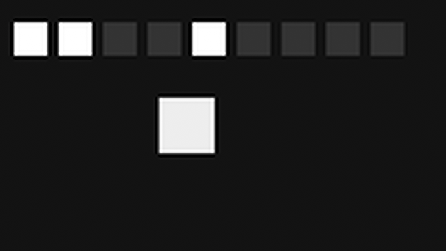
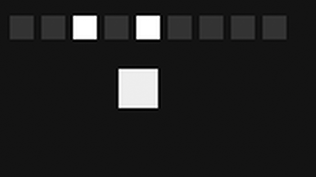

# Normal-stop terminal recreation and error cleanup: Windows

At source revision `f9cd456ebd5749024fe63e5548d1469ccc6a87e4`, fresh Windows
Debug and Release diagnostic builds passed the two selected CTests,
`test_c2a_hold_gate` and `test_c2_error_terminal`, in each configuration.
The normal-stop terminal-recreation control then passed in both configurations.
The render-failure and active-retirement diagnostics **remain failed** in both;
their error cleanup completed without clearing the strict failure latch.

This is a controlled, explicit second Play after normal Stop. It does not prove
fault quiescence, state restoration, user intent handling, web adoption, real
context-loss handling, or recovery from either failing diagnostic. The prior
failed proof records remain unchanged. Linux and macOS native results are not
established by this Windows checkpoint.

| Case | Debug | Release |
| --- | --- | --- |
| Render-failure cleanup | 2 passed, 1 failed, 0 skipped; complete footer | 2 passed, 1 failed, 0 skipped; complete footer |
| Active-retirement cleanup | 2 passed, 1 failed, 0 skipped; complete footer | 2 passed, 1 failed, 0 skipped; complete footer |
| Normal-stop terminal recreation | 3 passed, 0 failed, 0 skipped; complete footer | 3 passed, 0 failed, 0 skipped; complete footer |

Each failed application exited 1 and its helper exited 7. Each control
application and helper exited 0. All six helper logs report known zero active
processes before and after cleanup and no termination request; an exact-path
process check found no remaining task process. The failure logs still contain
the stuck-render and VO initialization diagnostics. The cleanup does not
reinterpret them as success.

## What the control exercised

For each configuration, the fixture loaded the generated clip as entry 1,
observed position advance from 533 to 766 ms and two distinct frames, then
issued Stop. Its source requires a successful Stop, a matching raw STOP
end-file event, idle, force-window `no`, current-VO unavailable, one canceled
transition, and render-worker progress. It repeatedly checks those terminal
conditions for at least 300 ms before retiring G1. The saved JSON records the
terminal values and final observation time; it does not separately record the
start and end of that 300 ms window.

After one matching G1 free and ACK, the fixture explicitly requested G2 on the
same original context and worker. Its recorded actual creation call count
advanced from 1 to 2, generation changed from 1 to 2, and the G2 call returned
0 before its matching GUI ACK. The fixture then issued a **new explicit Play**
as entry 2, again observed position advance from 533 to 766 ms and two
different frames, stopped normally, and observed the second free and ACK.
The exact identity and monotonic observations are in the copied JSON. Passing
source assertions check that the core, controller, binding and AC3 state
remain the same through those operations.

These are the actual Debug G2 frames viewed for this checkpoint. Their
SHA-256 values are respectively
`bf43990de9abb4ca30f802a3ee35cc3d54c97578243dcdac4e1199ef9833b4aa`
and `88a0fdaa0bb485ad1b3a6ee9d5c696caffbe92db548d1e92efa4071a5d41d8eb`.
They show different positions of the generated pattern; they are not evidence
of uninterrupted playback across retirement.

## Error cleanup evidence

All four failed diagnostics recorded the matching entry 1 end-file event with
reason 4 and error -15, with no cleanup Stop attempted. Each wrote an
error-terminal receipt after the error-terminal checks and `cleanup.finish()`
returned successfully, and retained the failing QTest footer. In the tested
source, `cleanup.finish()` checks worker join, context and surface destruction,
and cleanup ACK before join before surface destruction. The compact error
receipt itself does not serialize those individual audit values; that part of
the conclusion relies on the successful source-checked path, not invented raw
fields.

The adjacent [`c2-terminal-control-2026-11-04`](c2-terminal-control-2026-11-04/)
directory contains byte-identical bounded JSON observations and the two frames.
The JSON includes process-local diagnostic identities and no private paths.
Original QTest and helper logs remain local because they contain machine-specific
paths; their hashes below identify the unredacted bytes.

| Build evidence | Debug SHA-256 | Release SHA-256 |
| --- | --- | --- |
| Fixture executable | `9069a564068e2a474bebb74fd1937c236210a4445962e4ce1710064bc60eea60` | `65275ba8227cb46b1b5b7b52c7a4076978df9c66dd8db418f22a04a39100553e` |
| Guard CTest log | `9604b2985db34d9067295cf55d28c6669b447722a93b9d0d7c9b00896c707407` | `9fb92e593037217f1408dab3b14c41c2378f9bcadac2483853070815fe770043` |

| Case | QTest SHA-256 | Helper stdout SHA-256 | Helper stderr SHA-256 |
| --- | --- | --- | --- |
| Debug render | `498b65ce22a7c38e0843d0960e7ce825554f4d94f3c208b96a0d1b442d875350` | `8516f8407ae34e0b30e4ec4842879f39ddde08e9d6fad3ff5136d12e81b2d8d2` | `12a1cebf143efbd6f0f784ae42d8c85c8043c7f4ffd153a3d6edd45ed6fa59ec` |
| Debug active | `bf1578e25e88ece641dbc07092c1b930746a30c88c370e28df7a50bf59c4c287` | `029834ef5af3fadf5fcf3fe67f3ab116494f8729335db0555716b53476f1e0ff` | `3d4a7ebb6aa70e73fb3c37a03cd5f375f4d71d7c02c4823f4f0a4c3167268df7` |
| Debug control | `ccc4e226a62a508757a74cf10a6328f9469c0bbbe80615f3f47c71550885e6a5` | `cbc121b5d0405dbd60c0148a4453e6c5347baa031a10d7fc8d1a8f84f5e82b85` | `e3b0c44298fc1c149afbf4c8996fb92427ae41e4649b934ca495991b7852b855` |
| Release render | `05de27fba831c9421fee992284c662523335b859d35ceb492cb79f3359754035` | `f0e336729d033c52044c572b706691fec5c6d54999a8b590beca4ac014acc17f` | `3d814ecadb57747fea106a7fa93087460aa663c86d046db7e19b861be6cf4324` |
| Release active | `6e14907c3b4d468d8b2bfa711b0d1f7dcc0db4f49fefacd7de280d0a58818fc7` | `c6aa7db4e2d05981738626733e07beb20ea86b601e593b603e050a066df6931e` | `2903bbffd91f699fef21d7e1860d686eca21d855002538b0aa9b1768c0cf2d43` |
| Release control | `a392f959279bdb554fff803959170d1300f370626af933828422be0c03066bf3` | `2db6717ff3779b504a7b15bdd2f22613dd13236deb9dc2fad049616a4da43286` | `e3b0c44298fc1c149afbf4c8996fb92427ae41e4649b934ca495991b7852b855` |
